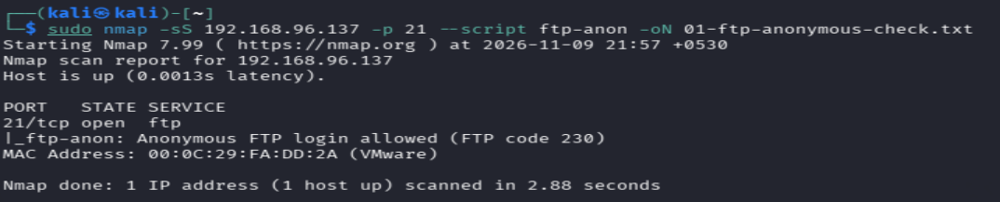
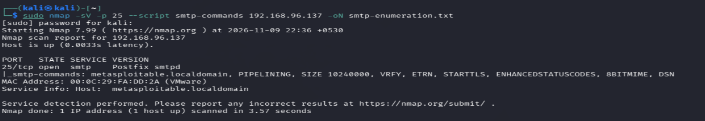
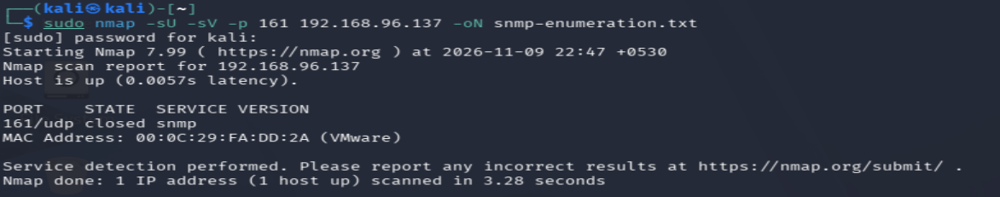

# Enumeration

## Project Overview

Enumeration is the process of gathering detailed information about discovered services, systems, and network resources. It helps identify accessible information that may be useful during a security assessment.

This project demonstrates practical enumeration techniques against an authorized lab machine using Nmap and Enum4linux.

## Objectives

- Identify information exposed by network services.
- Enumerate FTP, SMTP, SNMP, and SMB services.
- Understand how enumeration helps during security assessments.
- Save command outputs and supporting screenshots for documentation.

## Lab Environment

- **Operating System:** Kali Linux
- **Target:** 192.168.96.137
- **Environment:** Authorized VMware lab

## Tools Used

- Nmap
- Enum4linux

## Enumeration Activities

### 1. FTP Enumeration

FTP enumeration was performed using Nmap's `ftp-anon` NSE script to check whether anonymous FTP access was permitted on the target.

**Command:**
```bash
sudo nmap -sS 192.168.96.137 -p 21 --script ftp-anon -oN ftp-anonymous-check.txt
```

**Output:** [01-ftp-enumeration.txt](Outputs/01-ftp-enumeration.txt)

**Screenshot:**



### 2. SMTP Enumeration

SMTP enumeration was performed using Nmap's `smtp-commands` NSE script to identify the mail server and discover its supported SMTP commands and capabilities.

**Command:**
```bash
sudo nmap -sV -p 25 --script smtp-commands 192.168.96.137 -oN smtp-enumeration.txt
```

**Output:** [02-smtp-enumeration.txt](Outputs/02-smtp-enumeration.txt)

**Screenshot:**



### 3. SNMP Enumeration

SNMP enumeration was performed using Nmap to investigate the availability of the SNMP service and gather service information from the target.

**Output:** [03-snmp-enumeration.txt](Outputs/03-snmp-enumeration.txt)

**Screenshot:**



### 4. SMB Enumeration

SMB enumeration was performed using Enum4linux to gather information exposed through the SMB service, such as available shares, users, groups, and system details where accessible.

**Command:**
```bash
enum4linux -a 192.168.96.137 | tee smb-enumeration.txt
```

**Output:** [04-smb-enumeration.txt](Outputs/04-smb-enumeration.txt)

## Repository Structure

```text
02-Enumeration/
│
├── README.md
│
├── Outputs/
│   ├── 01-ftp-enumeration.txt
│   ├── 02-smtp-enumeration.txt
│   ├── 03-snmp-enumeration.txt
│   └── 04-smb-enumeration.txt
│
└── Screenshots/
    ├── 01-FTP-enumeration.png
    ├── 02-smtp-enumeration.png
    └── 03-snmp-enumeration.png
```

## Learning Outcomes

- Practiced service-specific enumeration techniques.
- Learned how to identify information exposed by FTP, SMTP, SNMP, and SMB services.
- Used Nmap NSE scripts for service enumeration.
- Used Enum4linux to investigate SMB information.
- Documented findings using command outputs and screenshots.

## Disclaimer

All activities in this project were performed in an authorized lab environment for educational purposes. These techniques should only be used on systems for which proper permission has been granted.
